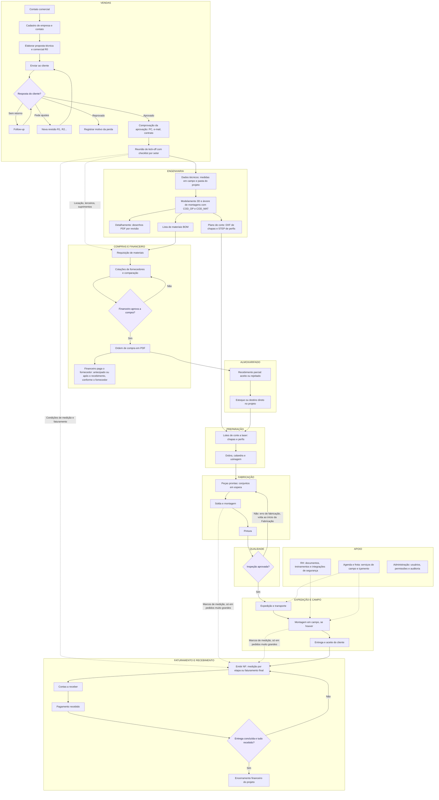

# Fluxograma operacional — Fabriaço (v3, rascunho validado em parte)

Gerado em 19/10/2026. Decisões confirmadas estão em REGRAS_DE_NEGOCIO.md. Renderiza no GitHub, VS Code (com extensão Mermaid) e em visualizadores Mermaid.

